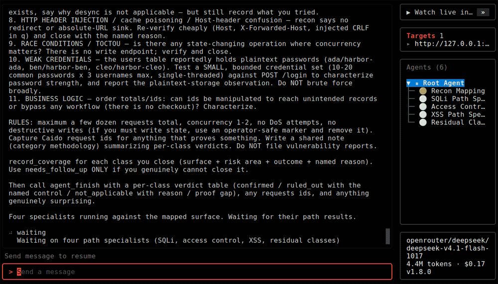
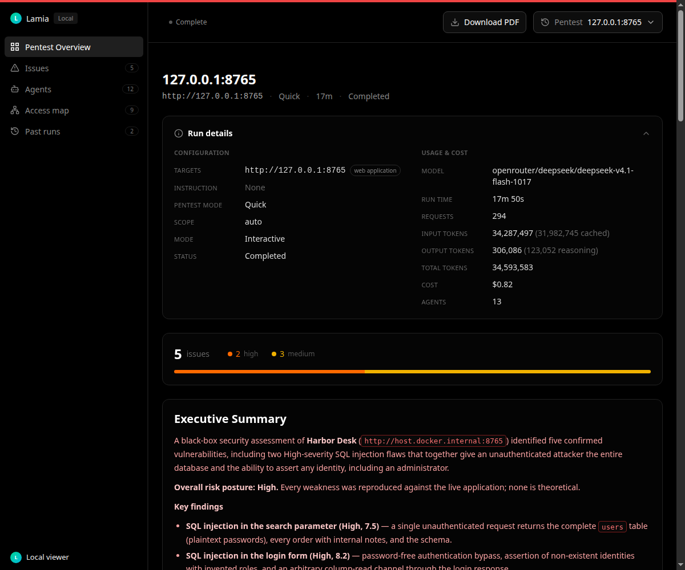
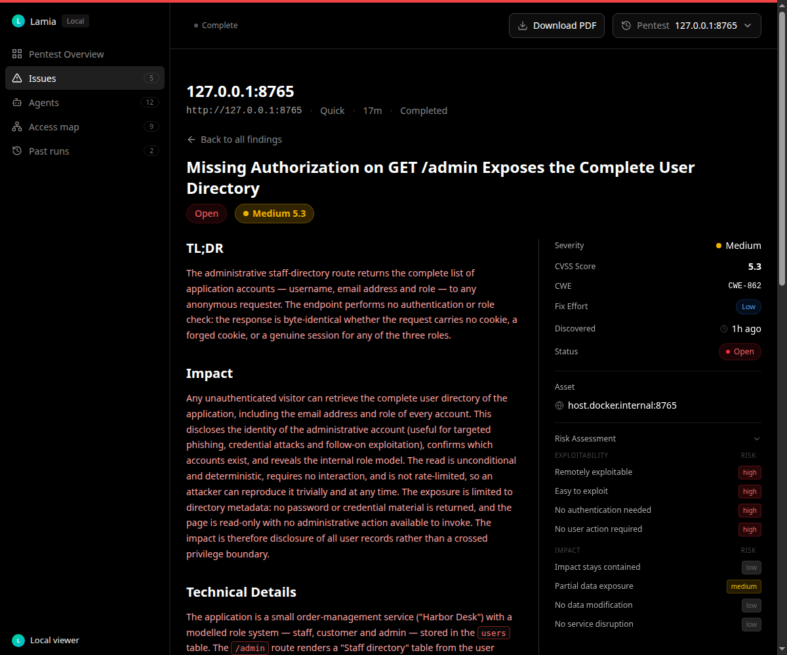
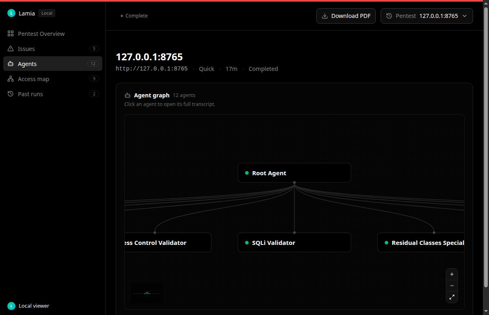
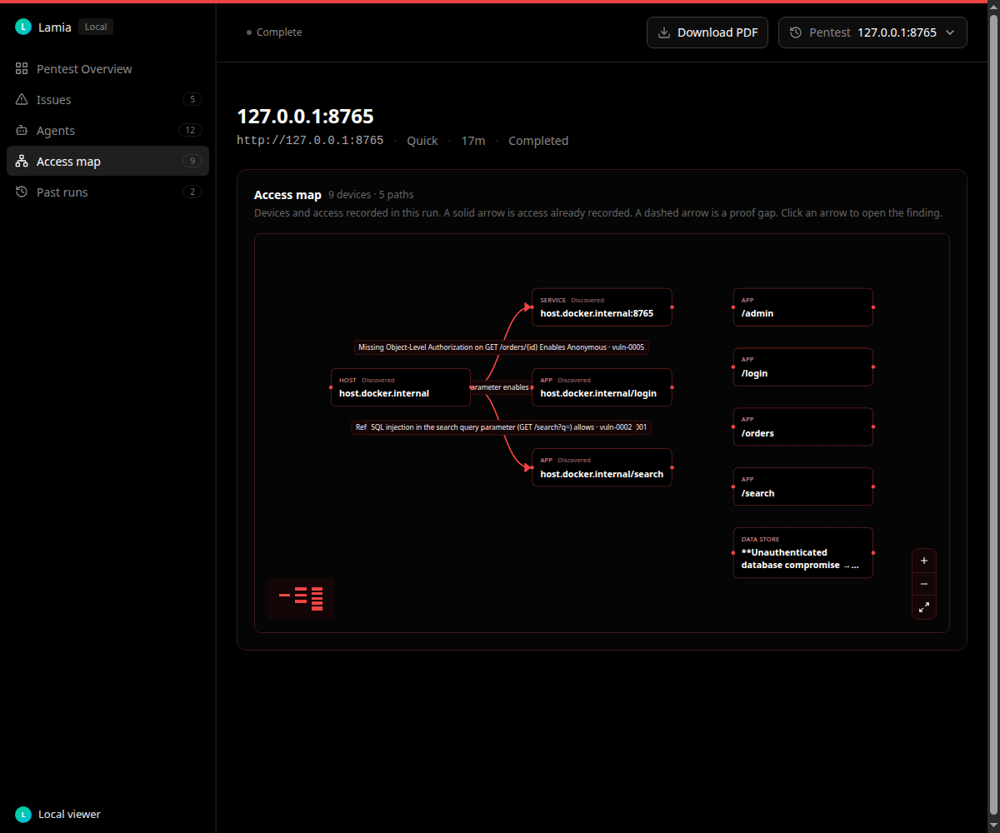

<!--
Copyright 2025 OmniSecure Inc.
Modified by the Lamia project from Strix.
-->

<div align="center">

# Lamia

### The open-source AI pentesting tool. Autonomous AI hackers that find vulnerabilities in your apps and report how to fix them.

<br/>

<a href="LICENSE"></a>
<a href="https://pypi.org/project/lamia-agent/"></a>

<br/>



A quick scan of a local lab on localhost.

</div>

Only run Lamia against systems you own or have explicit permission to test. The full notice is at the bottom of this page.

## Install and first scan

**Prerequisites:** Docker (running), and an LLM API key from a supported provider. See `docs/llm-providers/overview.mdx`.

```bash
# Install Lamia (pick one)
pipx install lamia-agent
# uv tool install lamia-agent
# curl -fsSL https://raw.githubusercontent.com/ProgramingPro2/lamia/lamia/scripts/install.sh | bash

# Configure your AI provider
export LAMIA_LLM="vercel_ai_gateway/zai/glm-5.3"   # Vercel AI Gateway
# export LAMIA_LLM="openrouter/z-ai/glm-5.3"       # OpenRouter
export LLM_API_KEY="your-api-key"

# Run your first security assessment
lamia --target ./app-directory
```

The default scan mode is `deep`. Add `--scan-mode quick` for a shorter run. The first run pulls the sandbox image. Results are saved to `lamia_runs/<run-name>`.

```bash
# Self-update the standalone binary
lamia --update

# ...or upgrade the package you installed
pipx upgrade lamia-agent
# uv tool upgrade lamia-agent
```

Installed with pipx, uv, or pip? `lamia --update` prints the matching upgrade command instead. Lamia also shows that command when a new version is available.

## What a run looks like

`lamia view` opens the run on this machine. Nothing is uploaded. These stills are from the same quick scan of a local lab on localhost.

```bash
lamia view                              # latest run
lamia view my-run-name                  # a specific run
lamia export                            # PDF of the latest run
lamia export my-run --format sarif      # also json, csv, markdown
```

`lamia view` binds to `127.0.0.1` and prints a tokened link. See `docs/usage/viewer.mdx`.

### Overview



Status, target, and how the findings break down by severity.

### Findings



Each validated issue, with severity and what to change.

### Agent graph



The team working the target, and what each agent is doing.

### Access map



Hosts, apps, roles, and data stores from the run. An arrow opens the finding it came from, or marks a path that is not proven yet.

## Common scans

```bash
# Local codebase
lamia --target ./app-directory

# GitHub repository
lamia --target https://github.com/org/repo

# Black-box web application
lamia --target https://your-app.com

# API contract plus the live base URL
lamia --target ./openapi.yaml --target https://api.your-app.com
lamia --target postman://<collection-uuid> --target https://api.your-app.com   # needs POSTMAN_API_KEY

# Grey-box, with instructions
lamia --target https://your-app.com --instruction "Perform authenticated testing using credentials: user:pass"

# Source and the deployed app
lamia -t https://github.com/org/app -t https://your-app.com

# One target per line
lamia --target-list ./targets.txt

# Headless, for servers and CI. Exit 0 is clean, 1 is a fatal error, 2 means findings.
lamia -n --target https://your-app.com
```

See `docs/usage/cli.mdx` for scan modes, diff scope, instruction files, and budgets.

### GitHub Actions

```yaml
name: lamia-penetration-test

on:
  pull_request:

jobs:
  security-scan:
    runs-on: ubuntu-latest
    steps:
      - uses: actions/checkout@v4
        with:
          fetch-depth: 0

      - name: Install Lamia
        run: pipx install lamia-agent

      - name: Run Lamia
        env:
          LAMIA_LLM: ${{ secrets.LAMIA_LLM }}
          LLM_API_KEY: ${{ secrets.LLM_API_KEY }}

        run: lamia -n -t ./ --scan-mode quick
```

A headless run in CI scopes a local git target to the pull request diff. The checkout fetches full history so that diff can be resolved. `--scan-mode quick` keeps the check short. Add `--fail-on high` to fail only at that severity or above. See `docs/integrations/github-actions.mdx`.

## Use Lamia from your coding agent

The workflows in `skills/` tell an agent how to run a local pentest, fix findings, and set up CI scanning against code, web apps, APIs, and the OWASP Top 10.

See [`AGENTS.md`](AGENTS.md). The rest of the documentation is in `docs/`.

## Models and configuration

```bash
export LAMIA_LLM="vercel_ai_gateway/zai/glm-5.3"   # Vercel AI Gateway
# export LAMIA_LLM="openrouter/z-ai/glm-5.3"       # OpenRouter
export LLM_API_KEY="your-api-key"

# Optional, for a local model such as Ollama or LM Studio
export LLM_API_BASE="your-api-base-url"
```

Lamia saves this to `~/.lamia/cli-config.json`. See `docs/advanced/configuration.mdx`.

Press **F2** in the TUI to set the provider, a masked API key, the model, scan mode, and budget before a run starts.

**Recommended models:**

- [Z.ai GLM-5.3 on Vercel AI Gateway](https://vercel.com/ai-gateway/models/glm-5.3) - `vercel_ai_gateway/zai/glm-5.3` (recommended)
- [Z.ai GLM-5.3 on OpenRouter](https://openrouter.ai/z-ai/glm-5.3) - `openrouter/z-ai/glm-5.3` (recommended)
- [DeepSeek V4.1 Flash on OpenRouter](https://openrouter.ai/deepseek/deepseek-v4.1-flash-1017) - `openrouter/deepseek/deepseek-v4.1-flash-1017`
- [OpenAI GPT-6.1 Sol](https://openai.com/api/) - `openai/gpt-6.1-sol` (needs [Daybreak](https://openai.com/daybreak/) access)
- [Anthropic Claude Opus 5.5](https://claude.com/platform/api) - `anthropic/claude-opus-5-5` (needs [CVP](https://support.claude.com/en/articles/14604842-cyber-verification-program) access)
- [Google Gemini 4 Argon](https://cloud.google.com/vertex-ai) - `vertex_ai/gemini-4-argon` (needs [Fairwind](https://deepmind.google/fairwind-program/) access)
- [DeepSeek V4 Pro](https://platform.deepseek.com) - `deepseek/deepseek-v4-pro`
- [Moonshot Kimi K3.1 Pro](https://platform.kimi.ai) - `moonshot/kimi-k3.1-pro`

See `docs/llm-providers/overview.mdx` for Vertex AI, Bedrock, Azure, and local models.

### ChatGPT subscription

```bash
lamia auth login chatgpt             # sign in with your ChatGPT account
export LAMIA_LLM="chatgpt/gpt-5.4"   # chatgpt/<model> runs on the subscription
lamia auth status                    # show the active sign-in, or logout to forget it
```

### Your own MCP servers

Create `~/.lamia/mcp-servers.json`. Each server's tools are namespaced by `name`, for example `github_list_issues`. See `docs/integrations/mcp.mdx`.

```json
[
  {
    "name": "github",
    "transport": "http",
    "url": "https://api.githubcopilot.com/mcp/",
    "auth": { "kind": "bearer", "token": "your-token" },
    "allowed_tools": ["list_issues"]
  }
]
```

## Coming from Strix

Lamia is a public fork of [Strix](https://github.com/usestrix/strix), published at [github.com/ProgramingPro2/lamia](https://github.com/ProgramingPro2/lamia). The agent graph, sandbox, and offensive toolkit come from that project. These are the parts a Strix user will notice. The longer notes on coverage, the access map, gated testing, and existing installs are in `docs/usage/from-strix.mdx`.

| | Lamia | Strix |
|---|---|---|
| Where a scan runs | On your machine, with your LLM key and Docker | Local CLI, or the hosted platform at app.strix.ai |
| Hosted account | None. There is no `lamia cloud` command | `strix cloud` drives scans, findings, and reports on the hosted platform |
| Reports | `lamia export` and a PDF download in `lamia view` | Hosted report delivery, plus the local run files |
| Scan modes | `quick`, `standard`, `deep`, `exhaustive` | `quick`, `standard`, `deep` |
| Deep mode | Stays on every applicable class on mapped in-scope surfaces until the budget runs out | Explores high-value paths, then stops |
| Viewer | Local dashboard, including an access map of hosts, apps, roles, and data stores | Local dashboard without that map |
| Interactive setup | F2 in the TUI sets the provider, model, key, and scan options | Flags and environment variables |
| Human-targeted testing | Allowed only after the operator names the population and the channel | Out of the default agent scope |

## Contributing

Contributions of code, docs, and skills are welcome. Start with `docs/contributing.mdx` and `CONTRIBUTING.md`.

## Acknowledgements

Lamia builds on the work of open-source projects like [LiteLLM](https://github.com/BerriAI/litellm), [Caido](https://github.com/caido/caido), [Nuclei](https://github.com/projectdiscovery/nuclei), [Playwright](https://github.com/microsoft/playwright), and [Bubble Tea](https://github.com/charmbracelet/bubbletea). Thanks to their maintainers.

## License

[Apache License 2.0](LICENSE). Strix is OmniSecure's project, and the copyright notice on this tree is Copyright 2025 OmniSecure Inc.

Files changed from Strix carry that copyright line and a line stating the Lamia project modified them. Copies left unchanged are not marked. [NOTICE](NOTICE) names the changed files that cannot hold a comment.

You may use, modify, and distribute Lamia, including in a commercial product. A redistribution has to keep this license and the existing copyright notice, and mark files you changed. Contributions sent for inclusion here are under the same license unless you say otherwise. Each contributor grants a patent license for claims that their contribution necessarily infringes; that grant ends if you sue alleging the work infringes a patent. The license does not grant rights in the project's names or marks. The software is provided as is, with no warranty and no liability for damages.

The authorized-use warning below is a project rule for running a scan. It is not a term of the Apache license.

> [!WARNING]
> **Authorized use only.** Lamia actively tests the targets you point it at, so only run it against systems you own or have **explicit, written permission** to test, and stay within the agreed scope. Unauthorized testing is illegal in most jurisdictions.
> You alone are responsible for obtaining authorization and complying with the law. Lamia is provided "as is" with no warranty or liability for misuse.
